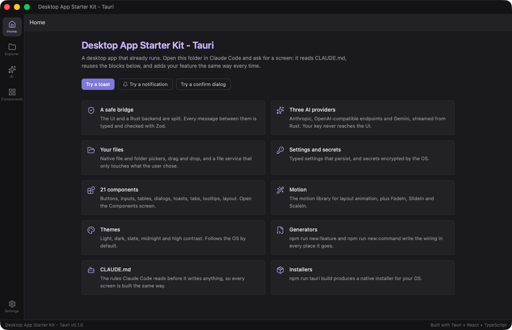
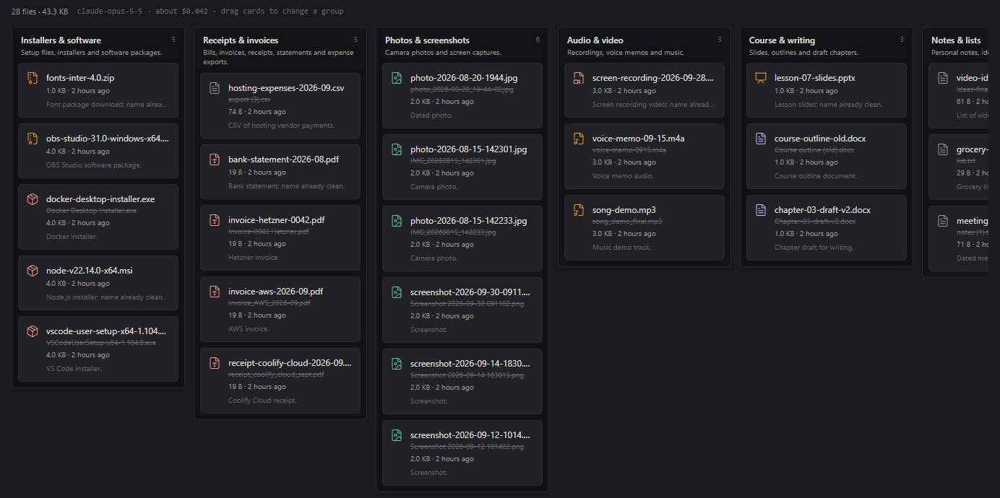

<p align="center">
  
</p>

<h1 align="center">Desktop App Starter Kit - Tauri</h1>

<p align="center">
  A free, MIT-licensed desktop app starter built for AI coding agents.<br />
  <strong>Tauri 2 (Rust) · React 19 · TypeScript · Tailwind CSS 4</strong>
</p>

<p align="center">
  <a href="./LICENSE"></a>
  
  
  
  
</p>

<p align="center">
  
</p>

---

## Contents

- [The idea](#the-idea) · [Why this starter](#why-this-starter) · [Resource use](#resource-use)
- [What's inside](#whats-inside)
- [Requirements](#requirements) · [Quick start](#quick-start)
- [Your first feature, with one prompt](#your-first-feature-with-one-prompt)
- [From starter to your app](#from-starter-to-your-app) · [Architecture](#architecture)
- [Project structure](#project-structure) · [Security model](#security-model)
- [Scripts](#scripts) · [Build an installer](#build-an-installer) · [Troubleshooting](#troubleshooting)
- [Status & roadmap](#status--roadmap) · [Docs](#docs) · [Contributing](#contributing) · [License](#license)

## The idea

Open this folder in Claude Code (or Codex, Cursor, Copilot) and ask for a screen in plain words.
The agent reads [`CLAUDE.md`](./CLAUDE.md) first, reuses the components and patterns that are already
here, adds your feature the way the rest of the app is built, and writes a test.

It does not have to rebuild the window, the typed bridge, the settings, the theming or the file
access for every new app — that is all wired and documented.

This is an unofficial **Tauri v2 port** of the original Electron starter,
**[hassancs91/desktop-app-starter](https://github.com/hassancs91/desktop-app-starter)** by **Hasan Aboul Hasan**.
The UI layer is adapted from that MIT-licensed project; the backend is Rust. This port is
independent and is not endorsed by or affiliated with the upstream author. See
[NOTICE.md](./NOTICE.md) for what was adapted and what was rewritten.

## Why this starter

Most starters give you a window and a component library. This one gives an agent a **rulebook** and
a **seam** it cannot accidentally cross:

| | |
| --- | --- |
| **One typed boundary** | The renderer only ever calls `window.api`, a façade typed in `src/shared/ipc/preload-api.ts` and implemented in `src/lib/bridge.ts`. There is no second way in. |
| **Everything privileged lives in Rust** | Windows, settings, secrets, files, dialogs, notifications, logging and AI provider calls are commands under `src-tauri/src/commands/`. The webview has `core:default` permissions and nothing else. |
| **Secrets never reach the UI** | API keys go to Keychain / Credential Manager / Secret Service via `keyring`. The renderer receives a masked preview. |
| **One rule per kind of code** | `CLAUDE.md` says where a screen, a command, a setting or a test goes — and lists the 16 mistakes agents make most often. |
| **Generators, not instructions** | `npm run new:feature` and `npm run new:command` write the wiring in every place it has to go. |
| **No bundled browser** | Tauri uses the system webview, so the app ships as a small native binary rather than a full Chromium runtime. See [Resource use](#resource-use). |

## Resource use

Measured on macOS 26.7 (Apple Silicon), release build, idle on the Home screen:

- **Disk** — about **5 MB** for the `.app`; the frontend is 688 KB across 3 files.
- **RAM** — about **60 MB** physical footprint: ~29 MB main process and ~31 MB WebKit helper
  (~83 MB peak). The WebKit framework itself is supplied by the OS and is not part of the install.
- **First-run data** — `app_data_dir` starts empty and holds `settings.json` and, on Linux without a
  Secret Service, the plaintext key fallback.
- **Updater** — none. There is no background download process.

Numbers vary by OS and by what the app is doing (streaming AI responses increases the webview
footprint, not the Rust core). There is no bundled Chromium, so install size and idle RAM stay
flat as the app grows — the work you add is your code, not another browser engine.

## What's inside

- **The window** — custom title bar, sidebar and status bar. A new screen is one entry in `screens-registry.ts`.
- **6 themes** — system, light, dark, slate, midnight, high contrast, all driven by CSS tokens.
- **Settings that persist** — typed in Rust with `serde`, validated in the UI with Zod.
- **Three AI providers** — Anthropic, OpenAI-compatible endpoints (OpenAI, OpenRouter, Groq, Ollama, LM Studio) and Google Gemini. Streaming text deltas from Rust to React; provider and model are settings, not hardcoded ids.
- **21 UI components** plus 8 layout and 3 motion primitives, all visible on the Components screen.
- **Files with a real allow-list** — native pickers, drag and drop, and a file service that only touches what the user chose.
- **A typed bridge** — 34 channels implemented as 29 Rust commands + 5 push events.
- **Installers for Windows, macOS and Linux**, wired through `tauri build` and a GitHub Actions release matrix.
- **Checks that run in CI** — TypeScript strict, ESLint, Vitest, `cargo fmt`, `cargo clippy -D warnings`, `cargo test`.

## Requirements

| | |
| --- | --- |
| Node.js | 20.19+ or 22.12+ |
| Rust | 1.77+ ([rustup](https://rustup.rs)) |
| Platform deps | [Tauri prerequisites](https://v2.tauri.app/start/prerequisites/) — Xcode CLT on macOS · MSVC build tools + WebView2 on Windows · `libwebkit2gtk-4.1-dev`, `build-essential`, `librsvg2-dev` on Linux |

## Quick start

```bash
git clone https://github.com/AniruddhaDas1/Desktop-App-Starter-Kit.git my-app
cd my-app
npm install
npm run tauri dev
```

The app opens. Visit the **AI** screen, choose a provider (Anthropic, an OpenAI-compatible endpoint,
or Google Gemini) and paste that provider's key once. The screen links to where each key lives.
Your OS stores it encrypted; the app only ever shows a masked preview.

The starter is free. Model calls are billed by the provider you choose.

> **macOS notifications:** macOS only delivers notifications from a bundled app, so the **Try a
> notification** button on the Home screen stays silent under `npm run tauri dev`. Build with
> `npm run tauri build` and open the `.app` — the first notification asks for permission.

## Your first feature, with one prompt

Open the folder in Claude Code and paste this:

> Add a screen called **Desk Cleaner**. The user drops a folder onto the window or picks one; default
> to their Downloads folder. Show every file as a card with its type icon, name, size and age,
> animated in. Send the file names, sizes and the first 300 characters of any text file to the AI
> provider in one request and ask it to group them into 5 to 8 plain-English categories and suggest a
> clean file name for each, with a one-line reason. Animate the cards flying into their category columns; let me
> drag a card to another column. A Clean up button moves and renames the files after a confirm dialog,
> with a progress bar and a notification when done. Nothing moves before Clean up. Follow the way the
> rest of this app is built, and write a test for the categorization service.

<p align="center">
  
</p>

Then verify what it built:

```bash
npm run typecheck && npm run lint && npm run test
cargo clippy --manifest-path src-tauri/Cargo.toml -- -D warnings
```

## From starter to your app

This repo is a starting point, not a framework. Turning it into your app takes five steps.

### 1. Give it a home

```bash
git clone https://github.com/AniruddhaDas1/Desktop-App-Starter-Kit.git my-app
cd my-app
npm install
```

Or click GitHub's **Use this template** button to get your own copy. Either way you
get an independent repo — do not open PRs against this repo for app features.

### 2. Make it yours

```bash
npm run rebrand -- --name "My App" --id com.me.myapp
npx tauri icon resources/icon.png
```

`rebrand` rewrites the app name and bundle identifier in `package.json`, every `tauri*.conf.json` and
`index.html`. Treat the identifier as permanent: OS notifications, keychain entries, the settings
directory and installer upgrades all key off it.

### 3. Keep the shell, replace the content

| Keep | Replace |
| --- | --- |
| `src/renderer/` — window chrome, sidebar, status bar, themes | The five demo screens in `src/features/` |
| `src/lib/bridge.ts` — the typed `window.api` seam | Their entries in `src/renderer/screens-registry.ts` |
| `src-tauri/src/` — state, settings, secrets, files, AI | Any demo copy on the Home screen |
| `src/shared/components/` — the component library | `docs/images/` screenshots |

The demo screens are examples of the patterns, not dependencies. Deleting one is deleting its
`src/features/` folder and its registry entry; nothing else imports across features.

### 4. Add your own pieces

```bash
npm run new:feature Invoices       # screen + registry entry
npm run new:command invoices:list  # Rust command + bridge + types
```

Then fill in the Rust body and call it from a hook as `window.api.invoicesList({ ... })`. Anything the
OS owns — files, network, keychain, native dialogs, notifications — belongs in a Rust command, not in
a component. Or skip the generators and ask the agent; it reads `CLAUDE.md` and does the same wiring.

### 5. Run, verify, ship

```bash
npm run tauri dev
npm run typecheck && npm run lint && npm run test
cargo clippy --manifest-path src-tauri/Cargo.toml --all-targets -- -D warnings
npm run tauri build
```

Build each installer on its own OS. Pushing a `v*` tag runs the release workflow, which builds macOS
(arm64 + x64), Linux and Windows artifacts and opens a draft GitHub release.

## Architecture

Two layers, one seam.

```
┌──────────────────────────────────────────────────────────────┐
│  React  (src/renderer, src/features, src/shared)             │
│  No OS access. No @tauri-apps imports.                       │
│                                                              │
│      window.api  ──►  src/lib/bridge.ts  (the only seam)     │
└───────────────────────────────┬──────────────────────────────┘
                    invoke()    │    emit() / listen()
┌───────────────────────────────┴──────────────────────────────┐
│  Rust  (src-tauri/src/commands)                              │
│  window · menu · settings · theme · secrets · fs · dialog    │
│  notification · log · ai                                     │
│                                                              │
│      AppState { settings, blessed paths, cancel tokens }     │
└──────────────────────────────────────────────────────────────┘
```

### Adding a command: 3 places

1. **Rust** — `src-tauri/src/commands/{domain}.rs`, listed in `commands/mod.rs`
2. **Registration** — an import in `lib.rs` + an entry in `generate_handler![…]`
3. **Bridge** — `src/lib/bridge.ts` + `src/shared/ipc/preload-api.ts` + types in `src/shared/ipc/types.ts`

`npm run new:command domain:action` scaffolds all three.

### Adding a screen: 1 place

```bash
npm run new:feature MyScreen
```

Creates `src/features/my-screen/` and registers it in `screens-registry.ts`. The Sidebar and the
router both read that registry — you never edit `App.tsx`.

## Project structure

```
src-tauri/                 Rust backend
  src/lib.rs               builder, plugins, window events, command registry
  src/state.rs             AppState: settings, blessed paths, cancel tokens
  src/error.rs             AppError -> { success: false, error, code? }
  src/commands/            one module per domain
  tauri.conf.json          window, CSP, bundle
  tauri.{macos,windows,linux}.conf.json   per-OS chrome
  capabilities/default.json

src/
  lib/bridge.ts            window.api implementation
  renderer/                shell, providers, hooks, theme tokens
  features/                one folder per screen
  shared/                  components, Zod schemas, AI model catalogue, types
  logging/                 renderer logger -> Rust
```

## Security model

- **Capabilities** — `src-tauri/capabilities/default.json` grants `core:default` only. Calling a
  Tauri plugin from JS requires an explicit permission entry; that is the one trap to know about.
- **CSP** — set in `tauri.conf.json`; scripts are `'self'` only.
- **Files** — `fs:*` is limited to `app_data_dir` plus paths the user picked or dropped. Symlinks are
  canonicalized before the check, so a blessed folder cannot be used to escape.
- **OS openers** — `app:open-path` and `app:show-in-folder` re-check the same allow-list and refuse
  executable extensions, so write-then-open cannot become code execution.
- **Secrets** — OS credential store only. Never in settings, logs or the webview.

See [SECURITY.md](./SECURITY.md) for scope and reporting.

## Scripts

| Command | Description |
| --- | --- |
| `npm run tauri dev` | Run the app with hot reload |
| `npm run dev` | Frontend only, in a browser |
| `npm run typecheck` | `tsc --noEmit` |
| `npm run lint` | ESLint |
| `npm run test` | Vitest |
| `npm run new:feature` | Scaffold a screen and register it |
| `npm run new:command` | Scaffold a Rust command in all 3 places |
| `npm run rebrand -- --name "My App" --id com.me.myapp` | Rename the app |
| `npm run tauri build` | Native installer for the current OS |

## Build an installer

```bash
npm run tauri build
```

Artifacts land in `src-tauri/target/release/bundle/` (`.dmg`/`.app` on macOS, `.msi`/NSIS on Windows,
`.deb`/`.AppImage` on Linux). Build each target on its own OS.

Builds are **unsigned** by default, so SmartScreen and Gatekeeper ask the user to confirm on first
launch. Code signing, notarization and auto-update are intentionally out of scope — see the roadmap.

To make it yours:

```bash
npm run rebrand -- --name "My App" --id com.me.myapp
npx tauri icon resources/icon.png
```

## Troubleshooting

| Symptom | Cause and fix |
| --- | --- |
| Window is blank after adding a plugin call | The webview only has `core:default`. Add the plugin's permission to `src-tauri/capabilities/default.json`. |
| **Try a notification** does nothing on macOS | Expected under `npm run tauri dev`; build the app and allow the permission prompt. |
| Linux build fails on `webkit2gtk` | Install the packages under [Requirements](#requirements). |
| Gatekeeper or SmartScreen blocks the first launch | Builds are unsigned; that warning is expected. See the roadmap. |
| A dropped file has no path | Read paths through `useFileDrop()`, never `dataTransfer.files` — see [CLAUDE.md](./CLAUDE.md). |
| Secrets warning on Linux | No Secret Service backend; the app falls back to a plaintext file in `app_data_dir`. |

## Status & roadmap

Verified on macOS: all 5 screens, all 34 channels, 6 themes, keychain-backed secrets, streaming
AI, allow-listed file access, drag and drop, generators, CI. Windows and Linux builds are wired but
not yet hand-verified — see the last roadmap item.

Known gaps versus upstream, all good first contributions:

- [ ] Full application menu (`File / Edit / View / Window / Help`, macOS app menu, `Cmd+,` → Settings)
- [ ] Single-instance lock and second-launch focus (`tauri-plugin-single-instance`)
- [ ] Renderer crash handler
- [ ] Explicit navigation guards (`will-navigate`, `<webview>` attach)
- [ ] Restrict the app data directory to `0o700` on POSIX at startup
- [ ] Code signing, notarization and auto-update
- [ ] Linux/Windows verification of the frameless title bar and native drag-drop

Cross-platform note: the window chrome differs by design — macOS uses an overlay title bar (traffic
lights), Windows and Linux use `decorations: false` with the app's own buttons.

## Docs

- [CLAUDE.md](./CLAUDE.md) — architecture, patterns and the agent rulebook (best overview for humans too)
- [docs/components.md](./docs/components.md) — every component and hook
- [docs/design-tokens.md](./docs/design-tokens.md) — colors, spacing, radius, motion
- [CONTRIBUTING.md](./CONTRIBUTING.md) — setup and the checks we run
- [NOTICE.md](./NOTICE.md) — upstream attribution and what changed

## Contributing

Issues and pull requests are welcome. Before opening a PR, run the same checks CI runs:

```bash
npm run typecheck && npm run lint && npm run test
cargo fmt --manifest-path src-tauri/Cargo.toml --check
cargo clippy --manifest-path src-tauri/Cargo.toml --all-targets -- -D warnings
```

The one rule that matters most: **the renderer talks to `window.api` and nothing else.** If a change
needs OS access, it belongs in a Rust command. See [CONTRIBUTING.md](./CONTRIBUTING.md).

## License

MIT — use it for anything, including apps you sell. See [LICENSE](./LICENSE).

## Credits & acknowledgements

This project exists because of an existing open-source Electron starter. Full credit:

- **[hassancs91/desktop-app-starter](https://github.com/hassancs91/desktop-app-starter)** — the
  original Electron-based starter by **Hasan Aboul Hasan**, used under the MIT License. Its UI layer,
  components, themes, Zod schemas, screen conventions and agent rulebook are adapted here. The
  upstream `LICENSE` and copyright notice are preserved. See [LICENSE](./LICENSE),
  [NOTICE.md](./NOTICE.md), and the pinned upstream commit:
  `9b95a85688123169329388d5a7f55cea14504f8d`.
- [Tauri](https://tauri.app) for the runtime and plugins.
- [Radix UI](https://www.radix-ui.com), [Tailwind CSS](https://tailwindcss.com),
  [Motion](https://motion.dev), [lucide](https://lucide.dev) and
  [TanStack Table](https://tanstack.com/table) for the UI layer.
